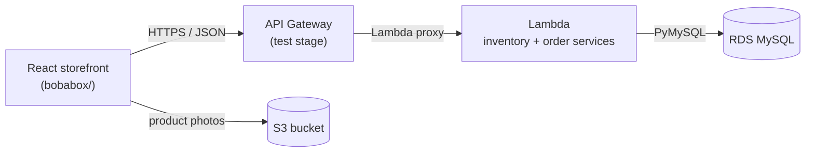

# BobaBox – CSE 5234 E-commerce Web App

Group project for CSE 5234 (Distributed Enterprise Computing).

BobaBox is an online-only store that ships DIY boba kits (tea, syrups, and tapioca pearls) to customers' homes. It is a three-tier application:

| Tier | Lab | Technology | Code |
| --- | --- | --- | --- |
| Presentation | 5–6 | React + Vite single-page app | [`bobabox/`](bobabox/README.md) |
| Business | 7 | AWS API Gateway + Lambda (Python 3.12) | [`lambda/lambda_function.py`](lambda/lambda_function.py) |
| Data | 8 | Amazon RDS for MySQL (+ S3 for product photos) | tables listed below |

## Architecture



The front end has no hardcoded catalog. Every product, price, and stock count comes from the inventory service, and every order goes through the order service.

### How a request flows

**Browsing the catalog**

1. `OrderProvider.jsx` calls `fetchInventory()` in `bobabox/src/api/inventory.js` when the app loads.
2. That sends `GET /inventory-management/inventory/` to API Gateway, which invokes the Lambda.
3. The Lambda runs `SELECT ... FROM ITEM` on RDS and returns the items as JSON (including each kit's S3 `IMAGE_URL`).
4. React renders the Products page and home page flavor cards from that response.

**Placing an order**

1. The customer adds kits to the cart, then enters payment → shipping → reviews the order.
2. "Place order" calls `submitOrder()`, which sends `POST /order-processing/order` with the cart lines, payment, and shipping info.
3. In one database transaction, the Lambda:
   - locks each ordered `ITEM` row (`SELECT ... FOR UPDATE`) and checks the requested quantity against `AVAILABLE_QUANTITY`;
   - if any line asks for more than is in stock, rolls back and returns `409 Insufficient quantity` (nothing is saved);
   - otherwise decrements `AVAILABLE_QUANTITY`, inserts `SHIPPING_INFO`, `PAYMENT_INFO`, `CUSTOMER_ORDER`, and one `CUSTOMER_ORDER_LINE_ITEM` per kit, then commits.
4. The Lambda returns a confirmation number (`BBA-` + the order's unique `CONFIRMATION_CODE`), which the confirmation page shows. The front end then re-fetches inventory so stock counts update.

## Business tier: API

Base URL: `https://74ltdmx4t1.execute-api.us-east-1.amazonaws.com/test`

| Service | Method & path | Description |
| --- | --- | --- |
| Inventory | `GET /inventory-management/inventory` | All items |
| Inventory | `GET /inventory-management/inventory/items/{id}` | One item by id (`404` if not found, `400` if the id is invalid) |
| Inventory | `GET /inventory-management/inventory/items?name=` | Items whose name contains the search text |
| Order | `POST /order-processing/order` | Submit an order; checks stock and returns a confirmation number |

Both services are handled by one Lambda function that routes on the HTTP method and path. Error responses:

| Status | When |
| --- | --- |
| `400` | Empty order, missing payment/shipping, invalid item id, or quantity below 1 |
| `404` | An ordered item does not exist |
| `409` | Requested quantity is more than `AVAILABLE_QUANTITY` (the whole order is rolled back) |
| `500` | Database or configuration error |

The Lambda reads its database connection from environment variables (`DB_HOST`, `DB_PORT`, `DB_NAME`, `DB_USER`, `DB_PASSWORD`), so no credentials are stored in this repo. PyMySQL is attached as a Lambda layer.

## Data tier: tables

| Table | Holds |
| --- | --- |
| `ITEM` | The catalog: item number, name, description, unit price, available quantity, S3 image URL |
| `CUSTOMER_ORDER` | One row per order: customer name and email, status, unique confirmation code, links to shipping and payment |
| `CUSTOMER_ORDER_LINE_ITEM` | One row per kit in an order: item number, name, quantity, link to the order |
| `SHIPPING_INFO` | Shipping address and email for an order |
| `PAYMENT_INFO` | Cardholder name, last 4 card digits, and expiration date. The CVV is never sent or stored. |

## Running it

```bash
cd bobabox
npm install
npm run dev
```

Open http://localhost:5173. The app talks to the deployed API by default; see [`bobabox/README.md`](bobabox/README.md) to point it at another stage.

To update the Lambda, paste `lambda/lambda_function.py` into the AWS Lambda console (handler: `lambda_function.lambda_handler`).
